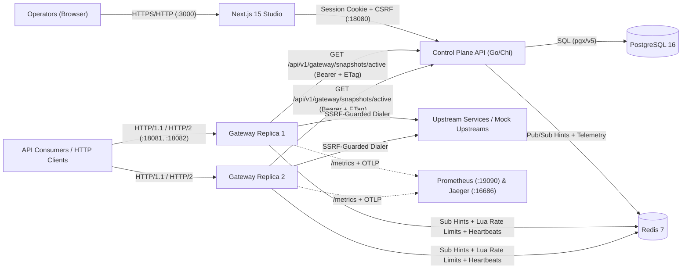

# GatewayForge Architecture and API Reference

## 1. System Topology

GatewayForge enforces strict separation between the **Control Plane** (tenant state, RBAC, configuration compilation, OpenAPI tools, audit log), the **Gateway Data Plane** (high-throughput reverse proxy, auth, distributed rate limiting, resilience), and the **Studio Web UI** (Next.js 15 App Router management dashboard).

### Plane Boundaries

| Component | Binary / App | Responsibilities | Explicit Non-Responsibilities |
|---|---|---|---|
| **Control Plane** | `cmd/control-plane` | Auth/sessions (Argon2id + HttpOnly cookies + CSRF), RBAC, org/service/upstream/route/consumer/policy CRUD, OpenAPI import/export, safe gateway-anchored console proxy, immutable snapshot compiler & activator, append-only redacted audit log, telemetry query API. | Never proxies external consumer traffic directly; never connects to arbitrary user-specified URLs from the console. |
| **Gateway Data Plane** | `cmd/gateway` | Zero-downtime snapshot sync (`atomic.Pointer`), deterministic route matching, API key & JWT/JWKS validation, Redis Lua sliding-window rate limits & quotas, CORS, active/passive upstream health checks, weighted load balancing, circuit breaker, bounded retries, per-route timeouts, Prometheus `/metrics`, OTel traces. | Never connects to PostgreSQL directly; never exposes operator credentials or admin mutations. |
| **Studio Web UI** | `apps/web` | Multi-tenant console for Dashboard, Services, Upstreams, Routes, Consumers, Policies, Releases/Diff/Rollback, API Console, OpenAPI Import/Export, Insights/Audit Explorer, and Settings. | Never persists API keys or session secrets in `localStorage`; never bypasses control-plane RBAC. |

---

## 2. Deterministic Route Matching Semantics

Implemented in [`internal/gateway/matcher/matcher.go`](../internal/gateway/matcher/matcher.go):

1. **Explicit Allowlist Only:** Requests that do not match an enabled route return `404 Not Found` (`application/problem+json`) with a correlation `X-Request-Id`. GatewayForge never acts as an open forward proxy.
2. **Host Normalization:** Incoming `Host` headers are trimmed, stripped of optional `:port`, lowercased, and stripped of any trailing dot (`.`). Malformed hosts containing whitespace or `/` are rejected.
3. **Segment-Boundary Prefix Matching:** `PathPrefix` is normalized without trailing slashes (except `/`). Prefix `/api` matches `/api` and `/api/v1/orders`, but **never** matches `/apiv2`.
4. **Deterministic Precedence Order:** Enabled routes are compiled and stably sorted by:
   1. `Priority` **descending** (higher integer wins).
   2. `len(PathPrefix)` **descending** (more specific prefix wins).
   3. `Route.ID` **ascending** (deterministic tie-breaker).
5. **Method Mismatch Handling (`405`):** If host and path match one or more routes, but the HTTP method does not match any of them, the gateway responds `405 Method Not Allowed` with a sorted `Allow` header listing every permitted method for that host+path.
6. **Path Normalization & Smuggling Defense:** Dot segments (`..`), encoded traversal, hop-by-hop header smuggling, duplicate conflicting `Content-Length`, and untrusted `X-Forwarded-*` spoofing are neutralized before routing and forwarding (`internal/gateway/proxy`).

---

## 3. Request Policy Pipeline Order

When a request matches a compiled route, the gateway executes policies in a fixed, predictable pipeline:

1. **Correlation & Tracing:** Assigns/sanitizes `X-Request-Id` and opens an OpenTelemetry span (`W3C traceparent` propagated).
2. **Body & Protocol Limits:** Enforces bounded request body size and strips hop-by-hop headers.
3. **CORS Policy (`cors`):** Evaluates allowed origins (rejecting `*` with credentials), preflight `OPTIONS`, methods, and headers.
4. **Consumer Auth (`auth`):**
   - `none`: public route.
   - `api_key`: extracts header/query key, compares constant-time SHA-256 hash against active non-revoked, non-expired consumer keys.
   - `jwt`: validates signature via JWKS (explicit asymmetric algorithm allowlist; `alg: none` and symmetric `HS*` substitution rejected), `iss`, `aud`, `exp`, and `nbf`.
5. **Rate Limit & Quota (`rate_limit`):** Executes atomic Redis Lua sliding-window counter (`internal/gateway/ratelimit`), emitting `X-RateLimit-Limit`, `X-RateLimit-Remaining`, `X-RateLimit-Reset`, and `Retry-After` on `429`. On Redis failure, strictly obeys route-configured `fail_open` or `fail_closed` mode.
6. **Resilience & Upstream Proxy (`timeout`, `retry`, `circuit_breaker`):**
   - Selects healthy weighted target via smooth weighted round-robin (`internal/gateway/balancer`).
   - Enforces per-route deadline budget (`timeout`), circuit-breaker state machine (`closed`/`open`/`half_open`), and bounded retries strictly restricted to idempotent methods (`GET`, `HEAD`, `OPTIONS`, `PUT`, `DELETE`) — non-idempotent `POST`/`PATCH` are rejected at policy validation time.
   - Connects via SSRF-guarded `net.Dialer` (`internal/shared/netsec`) blocking loopback, RFC1918 private ranges, link-local metadata (`169.254.169.254`), and DNS rebinding at connect time.

---

## 4. Control Plane API Contract

The canonical OpenAPI 3.1.0 specification lives at [`api/openapi.yaml`](../api/openapi.yaml) and is bidirectionally verified against the live Chi router by [`TestOpenAPIContractMatchesRouter`](../internal/control/api/openapi_contract_test.go).

Key contract invariants:
- **Tenant Scoping:** Every tenant endpoint is prefixed `/api/v1/orgs/{orgId}` and guarded by `RequireAuth → RequireOrgContext → RequirePermission`. Cross-tenant resource IDs return `403`/`404` without leaking existence.
- **Error Envelope:** All errors return RFC 7807 `application/problem+json` with `type`, `title`, `status`, `code`, `detail`, and `request_id`.
- **Optimistic Concurrency:** Mutable entities carry integer `revision` values and `ETag` headers; stale `PATCH` or release activation calls fail safely with `409 Conflict`.
- **CSRF Protection:** All cookie-authenticated mutations require matching `X-CSRF-Token` header.
- **Secret Handling:** Plaintext API keys are returned exactly once on `POST /consumers/{consumerId}/keys` or `POST /keys/{keyId}/rotate`; only SHA-256 hashes and prefixes are stored, and audit logs/diffs redact all secrets.

---

## 5. Environment Variable Catalog

Validated at startup by [`internal/shared/config/config.go`](../internal/shared/config/config.go). Invalid or missing production secrets cause immediate fail-fast exit without echoing secret values.

### Control Plane (`cmd/control-plane`)

| Variable | Default | Production Requirement | Purpose |
|---|---|---|---|
| `GATEWAYFORGE_ENV` | `development` | `production` | Runtime mode (`development`, `test`, `production`). Disables `/auth/bootstrap`, `cmd/seed`, and mock upstreams in production. |
| `CONTROL_PLANE_ADDR` | `:8080` | Valid `host:port` | HTTP listen address. |
| `CONTROL_PLANE_SHUTDOWN_TIMEOUT_SEC` | `10` | `1..300` | Graceful HTTP drain timeout on `SIGINT`/`SIGTERM`. |
| `DATABASE_URL` | `""` | **Required** (`postgres://`) | PostgreSQL 16 connection string. |
| `REDIS_ADDR` | `localhost:6379` | Valid `host:port` | Redis 7 address for Pub/Sub hints and telemetry aggregates. |
| `REDIS_PASSWORD` | `""` | Recommended | Redis authentication password. |
| `SESSION_SECRET` | `""` | **Required** (`>= 32` chars) | Secret key material for session integrity. |
| `GATEWAY_SYNC_TOKEN` | `""` | **Required** (`>= 16` chars) | Shared bearer token(s) for `/api/v1/gateway/snapshots/active` (comma-separated for zero-downtime rotation). |
| `CONTROL_PLANE_CORS_ORIGINS` | `http://localhost:3000` | Explicit origins (no `*`) | Comma-separated browser origins permitted for Studio API calls. |
| `ALLOW_MOCK_UPSTREAMS` | `true` (non-prod) / `false` (prod) | **Must be `false`** | Permits `mock-upstream` / `mock-upstream-2` destinations only in non-production environments. |
| `GATEWAY_PROXY_URL` | `""` | Internal gateway URL | Fixed target base URL for `/console/execute` (prevents arbitrary SSRF). |
| `TRACE_VIEWER_BASE_URL` | `""` | Optional Jaeger UI URL | Prefix used to build trace deep-links in Insights. |

### Gateway Data Plane (`cmd/gateway`)

| Variable | Default | Production Requirement | Purpose |
|---|---|---|---|
| `GATEWAYFORGE_ENV` | `development` | `production` | Runtime mode. |
| `GATEWAY_INSTANCE_ID` | `gateway-local-1` | Unique per replica (`1..64` chars) | Replica identifier for heartbeats and fleet convergence tracking. |
| `GATEWAY_ADDR` | `:8081` | Valid `host:port` | Reverse proxy listen address. |
| `GATEWAY_SHUTDOWN_TIMEOUT_SEC` | `15` | `1..300` | Bounded graceful drain window for in-flight streams. |
| `CONTROL_PLANE_URL` | `http://localhost:8080` | Valid `http(s)://` URL | Control plane endpoint for snapshot polling. |
| `GATEWAY_SYNC_TOKEN` | `""` | **Required** (`>= 16` chars) | Bearer token matching control plane sync token. |
| `GATEWAY_SYNC_INTERVAL_SEC` | `5` | `1..300` | Reconciliation polling interval (fallback when Redis Pub/Sub misses hints). |
| `GATEWAY_LKG_PATH` | `/tmp/gatewayforge-lkg.json` | Writable persistent volume | On-disk last-known-good snapshot cache for offline restart resilience. |
| `REDIS_ADDR` / `REDIS_PASSWORD` | `localhost:6379` / `""` | Valid `host:port` | Redis for Pub/Sub config hints, distributed rate limits, and heartbeats. |
| `ALLOW_MOCK_UPSTREAMS` | `true` (non-prod) / `false` (prod) | **Must be `false`** | Controls mock-host SSRF allowlist. |
| `OTEL_EXPORTER_OTLP_ENDPOINT` | `""` | Optional OTLP HTTP endpoint | Enables OpenTelemetry span export to Jaeger/collector. |

### Studio Web UI (`apps/web`)

| Variable | Default | Purpose |
|---|---|---|
| `NEXT_PUBLIC_CONTROL_PLANE_URL` | `http://127.0.0.1:18080` | Browser-facing control-plane base URL. |
| `CONTROL_PLANE_INTERNAL_URL` | `http://127.0.0.1:18080` | Server-side container-to-container control-plane base URL. |

---

## 6. Architecture Decision Records (ADRs)

- [ADR 0001 — Monorepo Layout and Control/Data Plane Separation](./adr/0001-monorepo-and-plane-separation.md)
- [ADR 0002 — Multi-Tenant RBAC Permission Matrix](./adr/0002-rbac-permission-matrix.md)
- [ADR 0003 — Server-Side Session and CSRF Model](./adr/0003-session-and-csrf-model.md)
- [ADR 0004 — Immutable Snapshot Synchronization and Last-Known-Good Protection](./adr/0004-snapshot-sync-and-last-known-good.md)

## 7. Related Documentation

- [Installation and Quickstart Guide](./QUICKSTART.md)
- [Administrator Operations Runbook](./ops/ADMIN_RUNBOOK.md)
- [Security Threat Model](./security/THREAT_MODEL.md)
- [Security Gap Report](./security/SECURITY_REPORT.md)
- [Benchmark Scorecard](./benchmarks/SCORECARD.md)
